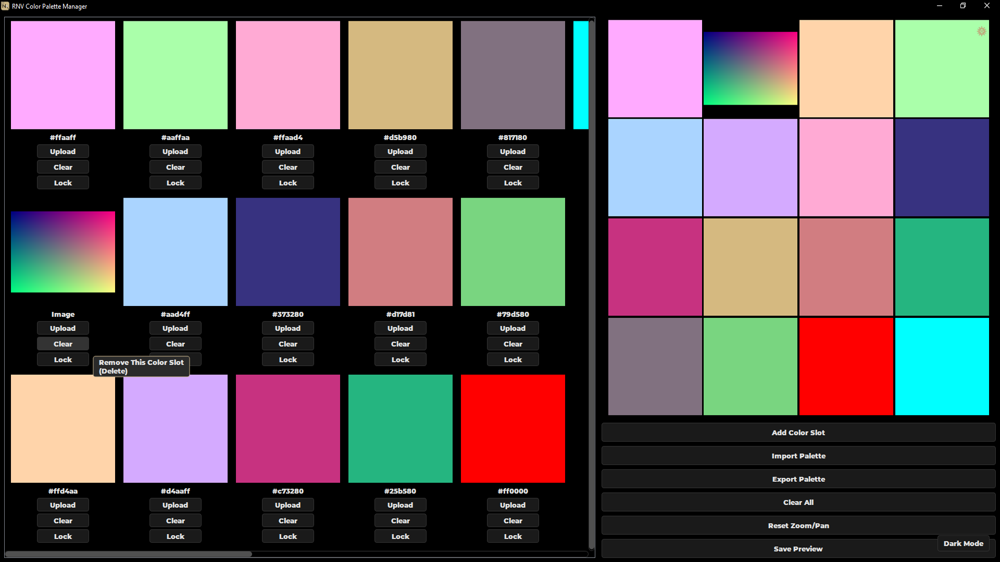
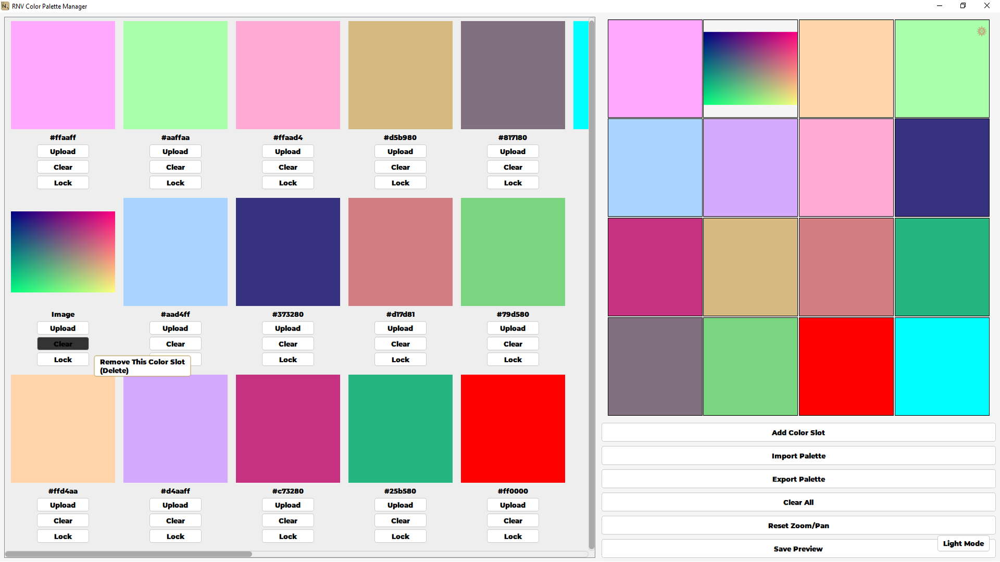
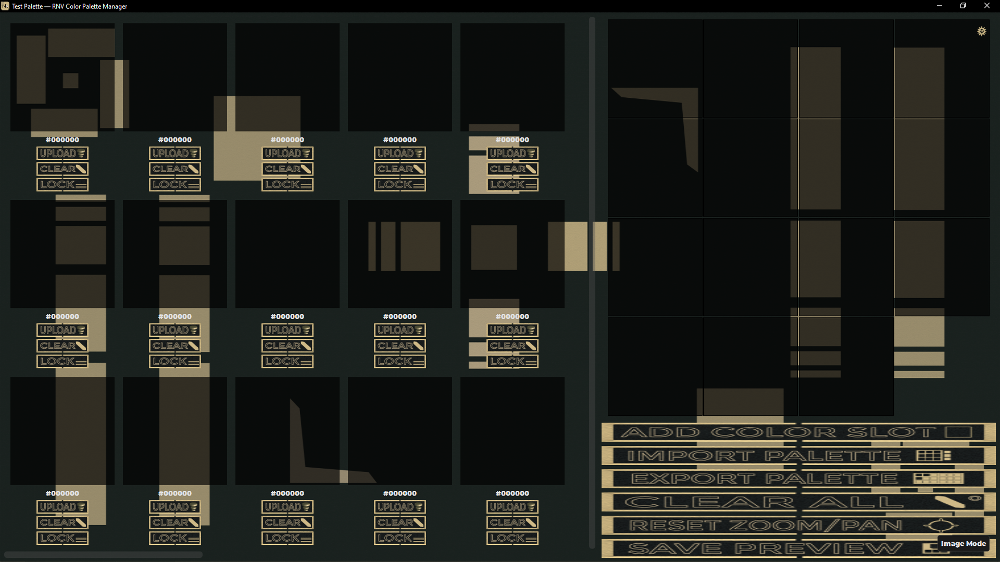
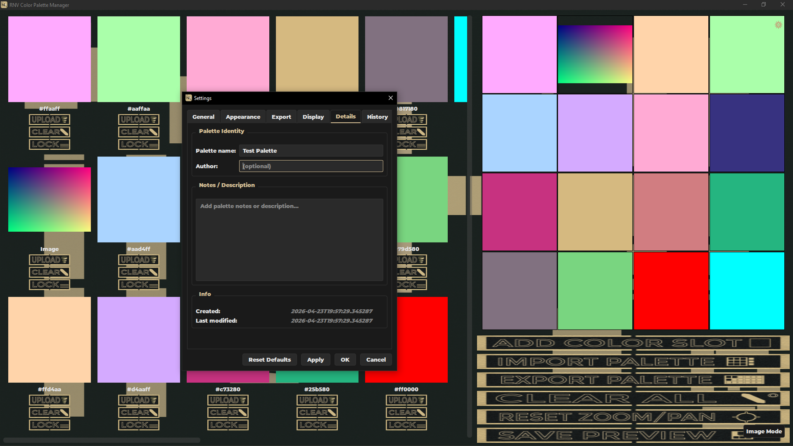
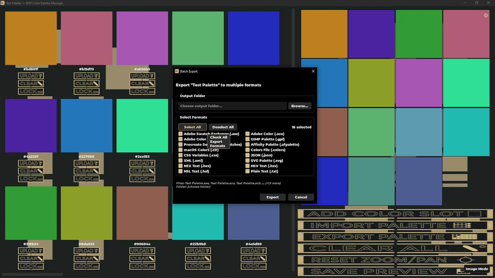
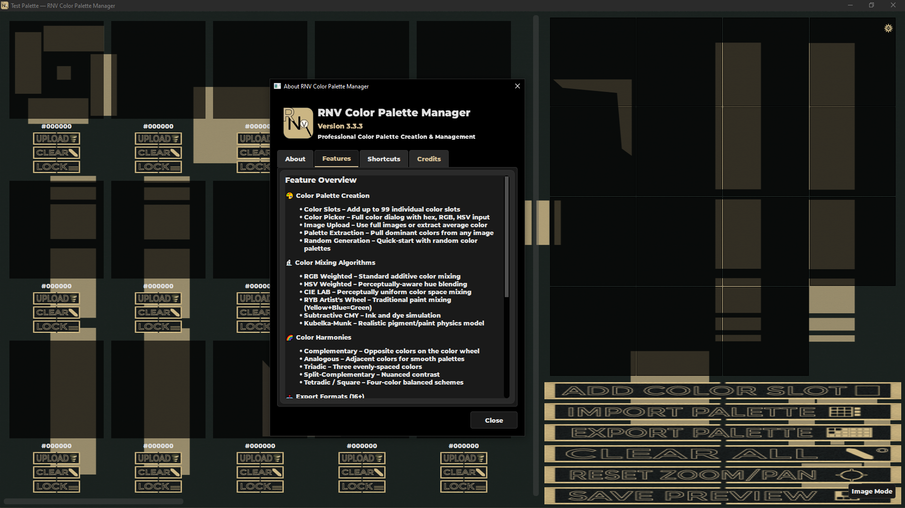

# RNV Color Palette Manager

A professional desktop application for creating, managing, and exporting color palettes — built with Python 3.13 and PyQt6.

[](https://www.python.org/downloads/)
[](https://pypi.org/project/PyQt6/)
[]()
[](LICENSE)
[]()
[](https://github.com/RNVizion/rnv-color-palette-manager/actions/workflows/tests.yml)
[](https://github.com/RNVizion/rnv-color-palette-manager/actions/workflows/tests-linux.yml)
[]()

---

> **Latest:** Cross-platform export consistency fixes and Linux CI added in `v3.3.13`. See [CHANGELOG.md](CHANGELOG.md) for details.

## Overview

RNV Color Palette Manager is a feature-rich color palette management tool designed for artists, designers, and developers. It supports color mixing with six algorithms (from an RGB average to Kubelka-Munk pigment simulation), color harmony and gradient generation, color extraction from images, accessibility contrast checking, color blindness simulation, and export to 16 professional palette formats (15 of which it can also import), including Adobe ASE/ACO, GIMP GPL, Procreate, and Affinity Designer.

The application features three visual themes (Dark, Light, and Image mode with a bundled background), a comprehensive keyboard shortcut system, session auto-save with crash recovery, and a clean modular architecture split into `core/`, `ui/`, and `utils/` packages.

## Screenshots

<p align="center">
  
  
  
</p>
<p align="center"><em>Three theme modes — Dark, Light, and Image (left to right)</em></p>

<p align="center">
  
  
</p>
<p align="center"><em>Tabbed Settings dialog (left) and Batch Export to multiple formats (right)</em></p>

<p align="center">
  
</p>
<p align="center"><em>About dialog — documentation, shortcuts, and credits</em></p>

## Features

### Color Palette Management
- Up to 99 individual color slots per palette
- Each slot has **Upload**, **Clear** (removes the slot) and **Lock** buttons; click a slot's hex label to copy its color
- Drag-and-drop slot reordering
- Named slot groups — rename, collapse/expand, add a slot to a group, delete a group (its slots join the previous group)
- Per-slot locking to protect colors during bulk operations
- Palette metadata (name, author, description, timestamps); the palette name shows in the window title
- Full undo/redo history (50-action depth)

### Color Creation & Mixing
- **Color picker** with hex, RGB, and HSV input
- **Image-based extraction** — upload an image to a slot, then show the image itself in the slot, use its average color, or extract 3–12 dominant colors (k-means) into new slots
- **Random generation** — single vivid colors or harmonious 3/6/9-color palettes
- **Color harmonies** — complementary, analogous, triadic, split-complementary, tetradic, monochromatic
- **Gradient generation** between any two slots, interpolated in CIE LAB
- **Color mixing** between any two slots, in equal parts, by one of six algorithms — RGB weighted, HSV weighted, CIE LAB perceptual, RYB artist's wheel, subtractive CMY (mixes like inks: each color filters the light, so yellow and blue make a dark green), and Kubelka-Munk pigment simulation; the mix is added as a new slot

### Accessibility
- **WCAG 2.1 contrast ratio checker** with AA/AAA pass indicators for normal and large text
- **Color blindness simulation** — Protanopia, Deuteranopia, Tritanopia, and Achromatopsia preview modes for the preview grid

### Import / Export
- **16 export formats, 15 of them importable** (see table below)
- **Batch export** — write the palette to multiple formats in a single operation
- **Recent palettes** menu with quick reload
- **Export history** tracking with file size and color count
- **Save Preview** — save the preview grid as a PNG or JPEG image

### Interface & UX
- Three visual themes — Dark, Light, and Image Mode, which draws the bundled background behind translucent slots
- Zoomable and pannable workspace
- Inline color search by hex, RGB, CSS name, or group name
- Persistent settings via platform-native storage (Windows Registry, macOS plist, Linux conf)
- Session auto-save and crash recovery
- Custom themed tooltips with branded styling
- Comprehensive keyboard shortcuts

## Supported Formats

| Format | Extension | Import | Export | Notes |
|---|---|:---:|:---:|---|
| Adobe Swatch Exchange | `.ase` | ✓ | ✓ | Photoshop, Illustrator, InDesign |
| Adobe Color | `.aco` | ✓ | ✓ | Photoshop |
| Adobe Color Book | `.acb` |   | ✓ | Photoshop libraries |
| GIMP Palette | `.gpl` | ✓ | ✓ | GIMP, Inkscape, Krita |
| Procreate Swatches | `.swatches` | ✓ | ✓ | iPad Procreate; import reads the simple format |
| Affinity Palette | `.afpalette` | ✓ | ✓ | Affinity Designer/Photo |
| macOS Colors | `.clr` | ✓ | ✓ | System color picker; import reads the XML variant only |
| Colors File | `.colors` | ✓ | ✓ | Hex and RGB per line, `#` comments |
| CSS Variables | `.css` | ✓ | ✓ | Web development |
| JSON | `.json` | ✓ | ✓ | Universal data interchange |
| XML | `.xml` | ✓ | ✓ | Structured metadata |
| SVG Palette | `.svg` | ✓ | ✓ | Visual reference; import is a basic extraction |
| HEX Text | `.hex` | ✓ | ✓ | Plain hex values |
| HSV Text | `.hsv` | ✓ | ✓ | Plain HSV values |
| HSL Text | `.hsl` | ✓ | ✓ | Plain HSL values |
| Plain Text | `.txt` | ✓ | ✓ | Hex and RGB per line, aligned with spaces |

## Installation

### Requirements
- Python 3.13 or higher
- PyQt6 6.5+
- Pillow 10.0+

### Clone and install
```bash
git clone https://github.com/RNVizion/rnv-color-palette-manager.git
cd rnv-color-palette-manager
pip install -r requirements.txt
```

`requirements.txt` also lists coverage, Hypothesis, pytest and pytest-qt, so this installs the core test tools too.

Alternatively, install as a package using the included `pyproject.toml`:
```bash
pip install .
```

After that, the `rnv-color-palette-manager` command starts the app.

### Run
```bash
python RNV_Color_Palette_Manager.py
```

### Build a standalone executable (optional)

A PyInstaller spec file is included for building a single-file executable that bundles Python, PyQt6, Pillow, and all resources into one downloadable binary. This is useful for sharing the app with users who don't have Python installed.

**Build scripts (recommended):** Convenience scripts that clean previous artifacts, run the test suite, and build the executable in one step.

```bash
# Windows
build_windows.bat                  # Test-gated build (default)
build_windows.bat --skip-tests     # Faster rebuild during development

# Linux / macOS
chmod +x build_linux.sh            # One-time: mark executable
./build_linux.sh                   # Test-gated build (default)
./build_linux.sh --skip-tests      # Faster rebuild during development
```

**Manual build (any platform):**

```bash
pip install pyinstaller
pyinstaller RNV_Color_Palette_Manager.spec
```

The output is written to `dist/`:
- **Windows:** `dist/RNV_Color_Palette_Manager.exe`
- **macOS / Linux:** `dist/RNV_Color_Palette_Manager`

The spec file defaults to one-file mode (single executable, slightly slower first launch). Edit `RNV_Color_Palette_Manager.spec` to switch to one-folder mode for faster startup — instructions are in the spec file's comments.

## Setting up for development

Two scripts at the repository root set up a checkout. Both install the same two files:
`requirements.txt`, which is what the app needs to run (here it also lists the core test
tools), and `tests/requirements-dev.txt`, which adds the test tools and rnv-brand at the
commit this repository pins.

```powershell
# Windows (PowerShell 7)
.\in.ps1                      # makes .venv with Python 3.13 if there is none, then installs
.\.venv\Scripts\Activate.ps1
```

```bash
# Linux or Codespaces
./in.sh                       # also installs the Qt system libraries with apt-get
```

rnv-brand is installed from GitHub at a pinned commit, so the second file needs `git` and
network access. Run the script again after any change that moves the pin; the
register-pin test fails while the installed brand is not the pinned one.

## Usage

Launch the app and the main workspace opens with a default grid of color slots (3 rows × 4 columns unless changed in Settings). Click any slot to open the color picker, right-click for a context menu, or drag to reorder. The right panel holds the preview grid and the buttons Add Color Slot, Import Palette, Export Palette, Clear All (removes every unlocked slot), Reset Zoom/Pan, and Save Preview. The gear at the top right opens Settings; the button at the bottom right shows the current theme and cycles it.

### Mouse

- **Click a slot** — open the color picker. With *Single-click to edit color* turned off in Settings, a click selects the slot and a double-click opens the picker.
- **Drag a slot** — move it to another position (locked slots stay put).
- **Click a slot's hex label** — copy the color in the Copy format set in Settings → Export (hex, rgb or hsl).
- **Upload / Clear / Lock** under each slot — upload an image to the slot, remove the slot, lock or unlock it.
- **Mouse wheel** — zoom the workspace; drag empty space to pan.
- **Right-click a slot** — Copy Hex, Copy RGB, Copy HSL, Duplicate Slot, Move Left, Move Right, Move to Group (when there is more than one group), Generate Harmony, Generate Gradient To..., Mix With..., and Check Contrast With.... The last three ask you to click a second slot: the gradient fills in the colors between the two, Mix With... asks for an algorithm and adds the two colors' mix as a new slot right after the first, and the contrast check shows the WCAG ratio and the AA/AAA results. While the app waits for that click, the top-right corner says *Click target slot*, whether or not the size overlay is on; `Escape` cancels.
- **Right-click Add Color Slot** — Add Random Color, Generate 3, 6 or 9 Random Colors, and Add New Group.
- **Right-click Import Palette** — recent palettes, Open folder, Remove missing files, and Clear recent list.
- **Right-click Export Palette** — export to a single format or batch export to several.

When there is more than one group, each group has a header: click the name to rename it, ▼ collapses or expands it, **+** adds a slot to it, and **×** deletes the group and moves its slots into the group before it.

### Keyboard Shortcuts

| Shortcut | Action |
|---|---|
| `Ctrl+N` | Add new color slot |
| `Ctrl+I` | Import palette |
| `Ctrl+E` | Export palette |
| `Ctrl+Shift+E` | Batch export to multiple formats |
| `Ctrl+S` | Save preview as image (PNG or JPEG) |
| `Ctrl+D` | Duplicate selected slot |
| `Ctrl+C` | Copy the selected slot's color in the Copy format setting (hex, rgb or hsl) |
| `Ctrl+Z` | Undo |
| `Ctrl+Y` / `Ctrl+Shift+Z` | Redo |
| `Ctrl+F` | Toggle color search bar |
| `Escape` | Cancel picking a target slot (Generate Gradient To..., Mix With..., Check Contrast With...); otherwise close the search bar if it is open; otherwise deselect the slot |
| `Ctrl+T` | Cycle theme (Dark → Light → Image) |
| `Ctrl+R` | Reset zoom and pan |
| `Ctrl+,` | Open Settings |
| `Ctrl+/` | Open About / Help |
| `Delete` | Remove selected slot (not when it is locked) |
| `Space` | Toggle lock on selected slot |
| `←` / `→` | Navigate between slots |
| `F10` | Toggle fullscreen |
| `F11` | Toggle tooltips |
| `F12` | Toggle size overlay |

A slot is selected with the arrow keys, or by clicking it when *Single-click to edit color* is off.

### Settings

The Settings dialog (`Ctrl+,` or the gear) has six tabs, with Reset Defaults, Apply, OK and Cancel:

- **General** — the starting grid's rows and columns, the default color for new slots (kept per theme), *Single-click to edit color*, session auto-save and its interval in minutes, and *Restore last session on startup*.
- **Appearance** — slot border (none, thin, thick), slot size (auto, small, medium, large), and the size-percentage overlay (the *Click target slot* hint shows in its place whatever this is set to).
- **Export** — the default export format, which the Export Palette dialog opens on (exporting a palette sets it to the format used), the Copy format (hex, rgb, hsl), the export history with Clear History, and how many recent palettes to keep (5, 10, 20) with Clear Recent List.
- **Display** — RGB and HSL values under each slot, and the color blindness simulation for the preview grid.
- **Details** — the palette's name, author and notes, with its created and last-modified times.
- **History** — the recorded color changes, how many to keep (50, 100, 200), and Clear History.

### Sessions and crash recovery

The workspace is saved to a session file on a timer (every 5 minutes unless changed in Settings → General) and again when you close the app, and it is restored at the next launch while *Restore last session on startup* is on. If the app did not close cleanly while auto-save was on, the next launch asks whether to restore the last saved session (one saved within the past 24 hours); declining discards it.

## Files the app keeps

Everything the app keeps for itself lives under `~/.rnv_color_palette_manager/`:

- `sessions/autosave.json` — the saved session
- `sessions/.recovery_needed` — the crash-recovery flag, present while auto-save is running
- `export_history.json` — the export history
- `logs/` — a log file per day

Settings and the recent-palettes list are kept by Qt's `QSettings` in the platform's own store.

The session, its recovery flag and the export history are written atomically through
`utils/atomic_write.py`: the new content goes to a temporary file beside the real one, is
flushed to disk, and replaces the original in one step. A crash or a full disk during a
save leaves the old file or the new one, never half of each. `QSettings` writes atomically
by itself. Exports you ask for, such as a palette file or an image, are not state and keep
their own writers. `tests/test_atomic_state_writes.py` lists every writer and fails if one
writes in place.

## Project Architecture

```
RNV_Color_Palette_Manager/
├── README.md                       # This file
├── ARCHITECTURE.md                 # Design decisions & tradeoffs
├── TESTING.md                      # Test suite guide & patterns
├── CHANGELOG.md                    # Version history & release notes
├── LICENSE                         # MIT license
├── .gitignore                      # Python / IDE / OS ignores
├── .gitattributes                  # Line endings; snapshots kept byte-exact
├── pyproject.toml                  # PEP 621 project metadata
├── brand_map.json                  # Where each color comes from: rnv-brand or the app
├── COLORS.md                       # This app's color chart, written by the sync
├── ACCENT_IMAGES.md                # Images with the gold drawn in, written by tools/accent_images.py
├── requirements.txt                # Quick-install dependencies
├── RNV_Color_Palette_Manager.py    # Main application entry point
├── RNV_Color_Palette_Manager.spec  # PyInstaller build spec
├── RNV_Color_Palette_Manager.pyproj # Visual Studio project file
├── test_rnv_palette_manager.py     # unittest baseline suite
├── run_tests.py                    # Unified runner for both test suites
├── .coveragerc                     # Coverage configuration
├── coverage_report.txt             # Last coverage report, written by run_tests.py
├── in.ps1                          # Development setup (Windows)
├── in.sh                           # Development setup (Linux / Codespaces)
├── build_windows.bat               # Test-gated PyInstaller build (Windows)
├── build_linux.sh                  # Test-gated PyInstaller build (Linux / macOS)
├── clean_python_cache.bat          # Dev convenience (Windows)
├── clean_python_cache.sh           # Dev convenience (macOS / Linux)
├── __init__.py                     # Root package marker
├── py.typed                        # PEP 561 typing marker
│
├── .github/
│   └── workflows/
│       ├── brand-sync.yml          # Daily: colors from rnv-brand; a PR only if one moved
│       ├── tests.yml               # CI: Windows test suite on push/PR
│       └── tests-linux.yml         # CI: Linux test suite on push/PR
│
├── core/                           # Color science & palette logic
│   ├── __init__.py
│   ├── py.typed
│   ├── color_math.py               # Color space conversions & mixing
│   ├── color_harmonies.py          # Harmony, gradient & random generation
│   ├── color_extractor.py          # K-means palette extraction
│   ├── color_slot.py               # Color slot widget & model
│   ├── palette_formats.py          # Import/export for every format
│   ├── palette_metadata.py         # Palette name, author, timestamps
│   └── accessibility.py            # WCAG contrast & CVD simulation
│
├── ui/                             # Qt widgets & theming
│   ├── __init__.py
│   ├── py.typed
│   ├── theme_manager.py            # Dark / Light / Image mode switching
│   ├── image_button.py             # Custom button with image-mode support
│   ├── image_upload_dialog.py      # Image upload workflow
│   ├── preview_grid.py             # Palette preview widget
│   ├── zoomable_graphics_view.py   # Zoom and pan workspace
│   ├── settings_dialog.py          # Tabbed preferences dialog
│   ├── about_dialog.py             # About / Help dialog
│   ├── slot_group.py               # Slot group data & header widget
│   ├── color_search.py             # Inline search bar
│   └── batch_export_dialog.py      # Multi-format export dialog
│
├── utils/                          # Infrastructure & helpers
│   ├── __init__.py
│   ├── py.typed
│   ├── colors.py                   # Theme colors; values written by tools/sync_colors.py
│   ├── config.py                   # Central config & resource paths
│   ├── logger.py                   # Colored console + file logging
│   ├── font_loader.py              # Custom font loading with fallback
│   ├── dialog_helper.py            # Themed message boxes
│   ├── error_handler.py            # Safe execution wrappers & validation
│   ├── file_utils.py               # Path handling & file operations
│   ├── atomic_write.py             # Atomic writes for the files the app keeps
│   ├── pil_compat.py               # Pillow API differences across versions
│   ├── pixmap_cache.py             # LRU cache for QPixmap objects
│   ├── settings_manager.py         # Persistent preferences (QSettings)
│   ├── session_manager.py          # Auto-save & crash recovery
│   ├── export_history.py           # Recent export tracking
│   ├── undo_manager.py             # Undo/redo stack
│   ├── recent_palettes.py          # Recent file menu
│   └── color_history.py            # Color change history panel
│
├── tests/                          # pytest suite (see TESTING.md)
│   ├── requirements-dev.txt        # Test/benchmark dependencies
│   ├── conftest.py                 # Shared fixtures & helpers
│   ├── color_values.py             # Color values the tests share
│   ├── test_qt_*.py                # pytest-qt widget, paint & drag/drop tests
│   ├── test_*_snapshots.py         # Export & import snapshot tests
│   ├── test_perf_*.py              # Benchmarks (pytest-benchmark)
│   └── test_*.py                   # Logic tests and the guard tests
│
├── snapshots/                      # canonical.* files the snapshot tests compare against
│
├── tools/                          # Maintenance scripts
│   ├── sync_colors.py              # Writes utils/colors.py and COLORS.md from the brand
│   └── accent_images.py            # Writes ACCENT_IMAGES.md
│
└── resources/                      # Bundled assets
    ├── button_images/               # Button icon images (base/hover/pressed)
    ├── background_images/           # Image Mode background
    ├── fonts/                       # Bundled Montserrat font
    ├── icons/                       # Application icons
    └── screenshots/                 # README preview images
```

`snapshots/` also holds a `test_import_snapshots.py`, an earlier version of the file in `tests/` that `python run_tests.py` does not run.

## Changing a color

The app's colors live in `utils/colors.py`, but their values are not edited there.
`brand_map.json`, at the repository root, says where each one comes from: a name in
rnv-brand (such as `APP.accent`) or a value this app owns, with the reason.
`tools/sync_colors.py` writes the value on each of those lines, and writes `COLORS.md`, the
chart of this app's colors.

- **A color this app owns:** change its value in `brand_map.json`, then run
  `python tools/sync_colors.py`.
- **A brand color:** it changes in rnv-brand first. Move the pin in
  `tests/requirements-dev.txt`, reinstall (above), then run `python tools/sync_colors.py`.
  The diff of `utils/colors.py` shows exactly what moved. The `brand-sync` workflow does
  this every day and opens a pull request only when a color this app uses has moved.
- `python tools/sync_colors.py --check` writes nothing and exits 1 if the color file or
  `COLORS.md` is out of date. `tests/test_colors_in_sync.py` runs it on every test run, so
  a value edited by hand in `utils/colors.py` fails the suite until the map says the same.

A derived color, such as a lightened or translucent step of the gold, stays code in
`utils/colors.py` and follows its base.

**The images do not follow.** Button art, backgrounds and icons have the gold drawn into
their pixels. `ACCENT_IMAGES.md` lists every image that carries it; `tools/accent_images.py`
writes that list (`--check` writes nothing) and never changes an image.
`tests/test_accent_images.py` keeps the list current.

## Testing

The project ships with a comprehensive test suite — **over 800 tests across two coexisting suites**, covering pure logic, Qt widget interactions, paint rendering, drag-and-drop, palette format roundtrips, performance benchmarks, and guard tests that hold rules across the repository.

### Quick start

```bash
pip install -r tests/requirements-dev.txt   # First-time setup (or run in.ps1 / in.sh, above)
python run_tests.py                   # Run both suites + coverage report
```

### What's tested

| Suite | Tests | Description |
|---|---|---|
| **unittest** (`test_rnv_palette_manager.py`) | over 300 | The baseline: pure logic, validators, palette format roundtrips, MainWindow integration smoke tests, undo/redo, settings, color history. New tests go in the `tests` folder. |
| **pytest** (`tests/`) | over 400 | Modern suite: Hypothesis property tests, format snapshots, pytest-qt interaction tests, paint event pixel sampling, drag-and-drop event handlers, performance benchmarks, guard tests. |

**Coverage:** Coverage is measured on every full run. `python run_tests.py --report` prints the current
figure for every module; it differs a little between Windows and Linux. CI prints the same
report and sets no minimum. The four dialogs (`ui/about_dialog.py`, `ui/batch_export_dialog.py`,
`ui/image_upload_dialog.py`, `ui/settings_dialog.py`) and `utils/dialog_helper.py` are left out
of the measurement in `.coveragerc`, so the figure says nothing about them; the uncovered code
it reports is in the modules that are measured. `python run_tests.py --summary` lists only the
modules with gaps.

### Continuous Integration

GitHub Actions runs the full suite on both Windows and Ubuntu Linux with Python 3.13 on every push and pull request to `main` or `master`, and on demand. Both workflows run independently — Windows is the primary target platform, Linux provides cross-platform verification. Status visible at the top of this README.

### Performance benchmarks

The pytest suite includes benchmarks of hot-path code (color space conversions, the color math in `core/color_math.py`, palette I/O). Run them in isolation:

```bash
python -m pytest tests/test_perf_*.py --benchmark-only
```

For the full guide to the test architecture, patterns for testing PyQt6 widgets in offscreen mode, the guard tests, and diagnostic tips, see [TESTING.md](TESTING.md).

## Tech Stack

- **Language:** Python 3.13 (leveraging `match/case`, `type` aliases, `|` union syntax, `pathlib`, `Final` annotations)
- **UI Framework:** PyQt6
- **Image Processing:** Pillow (PIL)
- **Testing:** Python `unittest`, pytest, pytest-qt, Hypothesis, pytest-benchmark, pytest-timeout, coverage.py
- **CI:** GitHub Actions (Windows + Ubuntu Linux runners, Python 3.13)
- **Color Science:** CIE 1976 L\*a\*b\* for gradients and mixing, Kubelka-Munk pigment theory, an RYB artist's wheel and multiplied transmittances (subtractive CMY) for mixing, sRGB gamma correction and WCAG 2.1 relative luminance for contrast, color vision deficiency matrices for the preview

## Design Principles

- **One map for colors** — theme values are named in `utils/colors.py` and written there from `brand_map.json` (see *Changing a color*); no hardcoded color literals elsewhere in the codebase, apart from the CSS color names the search recognizes
- **Package boundaries** — `core/` contains color science and palette logic, `ui/` handles presentation, `utils/` provides infrastructure; the one exception is `core/color_slot.py`, the slot widget, which uses `ui/` widgets
- **Type-annotated throughout** — modern Python 3.13 type hints on all public APIs
- **Fail-safe by default** — every file operation is wrapped in error handling; session state is auto-saved for crash recovery

For the reasoning behind these decisions, platform-specific workarounds, and tradeoffs considered, see [ARCHITECTURE.md](ARCHITECTURE.md).

## Related Projects

Part of the RNVizion suite of color tools:

- **[RNV Color Picker](https://github.com/RNVizion/rnv-color-picker)** — Professional color extraction and palette management for designers and developers.
- **[RNV Color Mixer](https://github.com/RNVizion/rnv-color-mixer)** — Bringing real-world paint mixing to the digital palette.

## License

This project is licensed under the MIT License — see [LICENSE](LICENSE) for details.

## Author

Built by [RNVizion](https://github.com/RNVizion)
